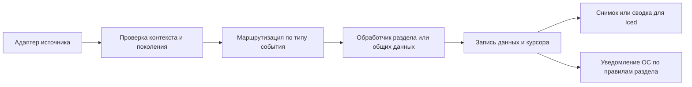

# Фундамент Workspace Desktop на Rust + Iced

Родительский документ — [план Workspace Desktop](workspace-desktop.md).

Пользовательские сценарии и границы продукта собраны в [карте функций](features/README.md).

Предлагаемый подход — один процесс и Cargo workspace из двух crates. `workspace-core` содержит логику приложения и запускается в тестах без GUI. `workspace-desktop` собирает приложение, подключает Iced и интеграции с ОС. Разделы пока остаются модулями внутри этих crates.

## Модули и ответственность

| Модуль | Чем управляет |
| --- | --- |
| [`core::bootstrap`](#bootstrap) | Общая точка входа для запуска сессий и фоновой работы. Вызывает модули и связывает завершение запуска с остановкой приложения. |
| [`core::auth`](modules/auth.md) | Реестр аккаунтов, вход, восстановление сессий и получение токенов для конкретного сервиса и контекста. Запросы, использующие одни и те же учётные данные, ждут одного обновления токена. |
| [`core::runtime`](modules/runtime.md) | Запускает и останавливает фоновые задачи для каждого авторизованного контекста. Владеет отменой задач, перезапуском после сбоев и завершением приложения. Выдаёт оболочке состояние синхронизации и сводки разделов. |
| [`core::sync`](modules/sync.md) | Принимает события от адаптеров, проверяет контекст, обрабатывает события по порядку внутри потока и направляет их владельцу данных. |
| [`core::sections`](modules/sections.md) | Разделы [`messenger`](modules/messenger.md), `mail` и `calendar` владеют своими данными и правилами. Общий контракт описывает применение события, сводку и открытие цели. |
| `core::directory` | Владеет общими данными пользователей и их присутствием в рамках контекста. Разделы читают их через этот модуль. |
| [`core::storage`](modules/storage.md) | Сохраняет данные и курсоры по ключу владельца. Позволяет зафиксировать изменение данных и продвижение курсора одной транзакцией. |
| [`desktop::shell`](modules/shell-platform.md) | Управляет окном, выбранным контекстом и маршрутом приложения. Передаёт переход нужному разделу и следит, что результат относится к текущему переходу. |
| [`desktop::messenger`](modules/messenger.md#маршрут-разговора) | Владеет списком чатов и экраном разговора. Список, уведомление и ссылка открывают один экран через общий маршрут. Мессенджер в `desktop` ведёт состояние загрузки, догрузки и прокрутки. |
| [`desktop::ui_kit`](modules/ui-kit.md) | Общая тема, переиспользуемые Iced-компоненты и их визуальное поведение. Компоненты получают данные и события от вызывающего кода. |
| [`desktop::platform`](modules/shell-platform.md) | Адаптеры системного хранилища секретов и уведомлений. Возвращает в приложение действие пользователя по нажатию на уведомление. |

Каждый модуль описываем отдельным документом в `modules/`. В таблице даём ссылку на его документ, а в документе модуля — ссылки на эту архитектуру и план проекта. По мере уточнения соседних модулей добавляем перекрёстные ссылки на их контракты и обновляем затронутые документы.

`workspace-desktop` зависит от `workspace-core`. Разделы используют общие типы контекста и подключаются к маршрутизации явно. Мессенджер, почта и календарь обращаются к сервисам через свои адаптеры и могут проверяться на тестовых источниках событий. Конкретные библиотеки для хранилища и интеграций с ОС выбираем при реализации.

### Организация экранов и модулей

Экраны группируем по разделам продукта внутри `crates/workspace-desktop/src/`. Мессенджер начинаем с `messenger/chat_list.rs` для списка чатов и `messenger/conversation.rs` для экрана разговора. Состояние экрана и обработку его действий держим рядом с экраном. `shell` отвечает за окно, выбор аккаунта и маршрутизацию между экранами. Первый перенос списка и истории выполняем при подключении [общего маршрута разговора](modules/messenger.md#маршрут-разговора).

Код для одного экрана держим рядом с ним. Если он нужен нескольким экранам одного раздела, выделяем приватный модуль внутри раздела. Для кода, общего для разных разделов, выбираем владельца по назначению. Например, виджет аватара относится к `desktop::ui_kit`, а получение данных пользователя — к справочнику в `core`. Правила доступа и работы с данными остаются в модулях `core`, вызовы ОС — в `desktop::platform`.

Выделяем модуль, когда у части кода есть отдельная ответственность, которую можно описать и проверять отдельно. Например, обработка жестов и восстановление позиции прокрутки могут стать внутренней частью экрана разговора. Начинаем с одного файла. Для модуля, которому нужны подмодули, используем папку с `mod.rs`, как в `core::messenger`. Размер файла сам по себе не повод делить его.

## Bootstrap

Окно Iced и команда `workspace-auth sync` вызывают `workspace_core::bootstrap::run`. Точка входа получает настроенный `runtime`, сигнал остановки и обработчик итога восстановления сессий. Окно сначала подписывается на события, чтобы получить начальные обновления. Затем Bootstrap запускает `runtime` вместе с восстановлением через `auth`. Каждый аккаунт начинает фоновую работу сразу после подтверждения своей сессии. При остановке Bootstrap передаёт сигнал в `runtime` и ждёт завершения его задач и начатых записей.

Bootstrap определяет порядок вызовов, а каждый модуль владеет запросами, обработкой и хранением своих данных. Когда сессия становится активной, Bootstrap вызывает [каталог Messenger](modules/messenger.md#начальная-загрузка-списка-чатов). Аккаунты загружаются независимо. Окно получает снимок состояния и может запросить повтор для текущего входа. Команда `workspace-auth sync` запускает синхронизацию без каталога окна. Начальный курсор, догрузка событий и счётчик «Все чаты» относятся к протоколу подключения Messenger. Переподключение ведёт `runtime` через адаптер источника. [Жизненный цикл фоновой работы](modules/runtime.md#запуск-переподключение-и-остановка)

## Сессии и задачи

- **Аккаунт** — сохранённая учётная запись в конкретном экземпляре Workspace. `auth` управляет доступом к разделам через общую точку входа и учитывает требования каждого сервиса к токену.
- **Контекст** — аккаунт, экземпляр Workspace, организация, проект и UUID пользователя. Он определяет владельца данных. Для каждого источника внутри контекста хранится свой курсор. Набор контекстов, которые можно синхронизировать, определяется доступом и политикой фоновой работы.
- **Поколение сессии** — локальный идентификатор запуска сессии, который несут запросы и события. Обновление токена сохраняет поколение. Выход и повторный вход меняют его. При записи `runtime` проверяет поколение вместе с фиксацией данных в рамках одного последовательного обработчика контекста. Запоздавший ответ прежней сессии отбрасывается.

Задача привязана к контексту и источнику, поэтому общий поток обслуживается одной задачей, даже когда его события нужны нескольким разделам. При переключении окна оболочка меняет выбор и сообщает, для какого контекста теперь нужен подробный снимок. Обработка событий остальных контекстов продолжается. При выходе `auth` отзывает право старого поколения на запись, а `runtime` отменяет задачи и убирает сводки аккаунта из оболочки. Остальные аккаунты продолжают работу.

Iced использует `Task` для команд интерфейса, например открытия темы, и одну подписку уровня приложения для получения изменений из `core`. Через неё приходят обновления снимков и сводок. Обновления интерфейса можно объединять, а при пропуске обновления интерфейс перечитывает актуальный снимок. Очередь входных событий ограничена. Если обработчик перегружен, чтение замедляется, а при разрыве поток восстанавливается от сохранённого курсора. Синхронизация продолжается, пока жив процесс приложения. Поведение при закрытии последнего окна зависит от режима работы в трее. [Документация Iced о Task и Subscription](https://docs.rs/iced/0.14.0/iced/index.html)

## Путь события

1. Адаптер получает событие через WebSocket, REST или другой механизм сервиса. Контекст берётся из авторизованной задачи, которая открыла соединение. Если событие содержит проект или получателя, адаптер сверяет их с этим контекстом.
2. `sync` направляет событие по его типу. Например, `message.created` обрабатывает мессенджер, а `user.updated` обновляет общие данные пользователей в том же контексте. Если событие затрагивает несколько хранилищ, курсор продвигается после применения всех изменений.
3. После фиксации данных обновляется сводка соответствующего аккаунта и раздела. Уведомление, если оно нужно, содержит этот же контекст и цель навигации. Ошибка показа уведомления оставляет данные и счётчики актуальными. По нажатию оболочка проверяет доступность контекста и передаёт [маршрут разговора](modules/messenger.md#маршрут-разговора) в `desktop::messenger`. Доступ к разговору подтверждает `core::messenger`.

**Пример.** В окне открыт календарь аккаунта A. Приходит сообщение аккаунта B. Задача B сохраняет сообщение и обновляет счётчик мессенджера B. Календарь A остаётся открытым. По нажатию на уведомление оболочка переключается на B и открывает разговор.

### Фоновая обработка и замеры

Активный и фоновые аккаунты по умолчанию обрабатывают все поддерживаемые события из своих WebSocket-подключений по одним правилам. Обычно обработчик применяет данные, которые уже пришли в событии. Если их недостаточно, сценарий определяет, нужна ли дополнительная обработка или запрос к серверу сразу, либо обновление можно отложить до обращения к данным. Обработка, нужная открытому экрану, выполняется при работе с ним. Например, реакция обновляется в локальном кэше независимо от экрана, а открытый чат сразу показывает изменение.

В мессенджере выделяем отдельные обработчики для сообщений, реакций и счётчиков. Одно событие может запустить несколько обработчиков. Например, новое сообщение обновляет историю и счётчик непрочитанных. Явно описываем зависимости между обработчиками, чтобы конфигурация прогона учитывала их. Отключение обработчика сохраняет тот же источник событий и подключение.

Для сравнения прогоняем один поток событий на одинаковых начальных данных и с одинаковым числом аккаунтов. Начинаем со всех поддерживаемых обработчиков, затем отключаем по одному, например обновление счётчиков или реакций. Сравниваем CPU, память, записи в хранилище, задержку обработки и время открытия чата после работы в фоне. Рабочий набор обработчиков определим по этим замерам. Если полная обработка укладывается в требования по ресурсам и отклику, оставляем её включённой.

Сравнительные прогоны используют изолированный кэш и курсор. Если позднее понадобится переключать обработчики в рабочем режиме, перед включением восстанавливаем их данные из серверного снимка или переигрываем пропущенное. Общий курсор потока может уже продвинуться за события, которые обработчик пропустил. Обязательные изменения, например отзыв доступа и удаление защищённых данных из кэша, применяются при любой конфигурации.

[Базовый замер фоновых сообщений](modules/background-messenger-baseline.md) описывает воспроизводимый прогон и его ограничения.

### Первый источник — Workspace Messenger

При старте и после обрыва адаптер догружает события по REST, затем открывает WebSocket с сохранённой парой `epoch_generation` и `epoch_version`. Оба транспорта используют один путь обработки. Повторы сверяются с сохранённым курсором. До `ready` догоняющие события обновляют данные и счётчики без системных уведомлений. Если курсор истёк, адаптер сбрасывает затронутый производный кэш и восстанавливает снимки с сервера. Контракты почты и календаря уточняем перед их подключением. [Контракт событий Workspace API](../../../workspace_backend/docs/ru/workspace_ui_realtime_integration.md)

## Проверка фундамента

- Два аккаунта и два раздела. Событие в закрытом разделе аккаунта B обновляет его сводку, пока в окне открыт раздел аккаунта A. По нажатию на уведомление открывается правильный контекст.
- Разрыв соединения и повтор события. Проверяем восстановление с сохранённого курсора, итоговое состояние и отсутствие повторного уведомления при переподключении.
- Выход из B во время запроса и повторный вход. Старый ответ не меняет данные новой сессии. Синхронизация A продолжается.
- Сбой записи между применением события и фиксацией курсора. Транзакция оставляет данные и курсор согласованными, а событие можно применить после перезапуска.

Эти сценарии запускаются без Iced на тестовом источнике. Отдельно проверяем на целевых ОС сворачивание окна и переход по системному уведомлению. Для воспроизведения сбоев в журнале достаточно контекста задачи, источника, состояния соединения и курсора. Токены и содержимое сообщений в журнал не попадают.
